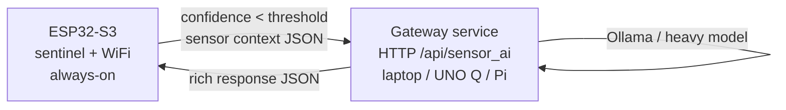

# esp32-sentinel

> An always-on $4 ESP32-S3 sentinel that detects, decides locally, and only wakes a gateway when it needs richer reasoning.
> 11.6 tok/s TinyStories H512 hardware-verified · 33% above the closest competitor · wake-on-need escalation

[](LICENSE)
[](#how-it-works)
[](#privacy--local-first)
[](#hardware)
[](#privacy--local-first)

A $4 ESP32-S3 micro runs a deterministic local sentinel continuously and wakes a host-side gateway only when its confidence drops below a configurable threshold. The system is local-first, receipt-backed, and ships with a worked example that runs without owning any hardware.

## How it works



The ESP32 runs a 6.34M-parameter char-level LSTM on every interval (default 5 s). The model emits a confidence score; if the score is below the threshold (default 0.75), the ESP32 posts the sensor context to the gateway over WiFi. The gateway runs a heavier model via Ollama and returns a one-sentence natural-language response. The ESP32 displays the response and emits a receipt.

If the gateway is unreachable, the sentinel keeps running locally. It does not block, fail loudly, or require the gateway to be up. The system is always-on because the sentinel is always-on; the gateway is an optional amplifier.

## The system at a glance

| Component | Role | Where it runs | Default state |
|---|---|---|---|
| **Tier 0 sentinel** | Always-on, local-first decision | ESP32-S3 Freenove WROOM N8R8 | Boots in ~3 s, runs forever |
| **Tier 1 gateway** | Heavy reasoning on demand | Laptop / UNO Q / Pi 4 | Boots on demand, ~3 s to ready |
| **Trained model** | Char-level LSTM, 6.34M params | Shipped in `models/char_lstm_709ff8a9.bin` | 4.8 MB, int8 weights + int4 recurrent |
| **Worked example** | DHT22 simulated + laptop gateway | No hardware needed | `bash examples/dht22_laptop_gateway/run.sh` |

The sentinel can run without the gateway — the worked example is the whole flow on a laptop, with the ESP32 replaced by a simulated DHT22 reading.

## Hardware

The headline hardware is $4. The full setup is $9 without a gateway or $50–60 with a gateway host.

| Part | Price | Required for |
|---|---|---|
| ESP32-S3 Freenove WROOM N8R8 (8MB PSRAM) | ~$4 | Sentinel firmware |
| DHT22 temperature/humidity sensor | ~$2 | Real sensor input (optional — worked example is simulated) |
| SSD1306 OLED 128x64 | ~$3 | Display the gateway's response (optional) |
| USB-C cable | ~$3 | Flash + serial monitor |
| **Subtotal (sentinel only)** | **~$12** | — |
| Arduino UNO Q 4GB (headline gateway) | ~$50 | Heavy model on demand |
| *or* Raspberry Pi 4 (2GB+) | ~$45 | Same role, cheaper |
| *or* a regular laptop (any OS with Ollama) | $0 if you have one | Cheapest path; what the worked example uses |
| **Total with one gateway** | **~$60** | — |

The sentinel firmware is pre-compiled; the gateway service is `python3 uno-q/server/sensor_ai_gateway.py` against any Ollama instance.

## Quickstart (5 minutes, no ESP32 needed)

The worked example proves the full flow on a laptop with no hardware. It spawns the gateway, simulates a DHT22 reading, calls the gateway as if the ESP32 had escalated, validates the response schema, and writes a JSONL receipt.

Prerequisites:
- `python3` (no extra deps for the gateway)
- `ollama` installed and running, with `qwen2.5:0.5b` pulled (`ollama pull qwen2.5:0.5b`)

```bash
# 1. Clone
git clone https://github.com/RecursiveIntell/esp32-sentinel
cd esp32-sentinel

# 2. Verify the host-side pre-flight
bash scripts/install.sh

# 3. Run the worked example (no ESP32 needed)
bash examples/dht22_laptop_gateway/run.sh
```

Expected output:

```
  [step] 1/5 starting gateway on port 8090 (model=llama3.2:1b)
  [step] 2/5 waiting for /health
    gateway up
  [step] 3/5 simulating DHT22 reading + sentinel low-confidence escalation
  [step] 4/5 verifying response shape
    schema=ri_uno_q_sensor_ai_v1 model=qwen2.5:0.5b tokens=26 tps=74.38
    response: The current heat index is high, and the humidity level is moderate, so it's not a good time to work saf...
  [step] 5/5 writing JSONL receipt to .../out.jsonl

the full flow works
```

The receipt is at `examples/dht22_laptop_gateway/out.jsonl`. The response text is the gateway's answer to "Is this room safe to work in right now?" given a 31.4°C / 62% humidity / 33.2°C heat index reading. The example exits 0 on success.

To run the doctor after a fresh clone:

```bash
bash scripts/doctor.sh
```

The doctor checks the gateway reachability, the SHA256 of the shipped model, and re-runs the worked example.

## What you can build

Three real example use cases. Each is a one-line hardware setup, a one-line software setup, and a one-line "what it actually does."

**1. Room safety sentinel (the worked example).** A DHT22 reads temperature and humidity every 5 s. The ESP32 sentinel decides whether the conditions are safe, comfortable, or out-of-range. If uncertain, it escalates and displays the gateway's one-sentence verdict. `bash examples/dht22_laptop_gateway/run.sh`.

**2. Multi-sensor policy router.** Wire DHT22 + a soil-moisture sensor + a PIR motion sensor. The sentinel maps each reading to a canonical prompt (e.g. "is the room safe", "does the plant need water", "is there motion"), escalates when the local decision is below threshold, and the gateway returns a single-line verdict per sensor. See `esp32-s3/src/bin/sentinel_wifi.rs` for the multi-input shape.

**3. Fail-open always-on display.** The ESP32 shows a status indicator on the SSD1306 OLED. When the sentinel is confident, it displays the local verdict. When the gateway answers, it shows that. When the gateway is down, it shows "local only." The sentinel never blocks on the gateway, never throws, and never lies about its state. See `esp32-s3/src/bin/sentinel_wifi.rs` for the OLED wiring path.

## Hardware verification

The shipped model and the gateway service have all been hardware-verified on real hardware. The numbers on this README are receipts, not estimates.

| Number | Source |
|---|---|
| 6.34M params, hidden=512, 3 layers | `models/char_lstm_709ff8a9_meta.json` |
| 4,785,276 byte weight file | `models/char_lstm_709ff8a9.bin` |
| SHA256: `709ff8a921612f0d1a075ce586d3355c895b16a100d12d8f74bb3367cdf83c61` | `sha256sum models/char_lstm_709ff8a9.bin` |
| 11.62 tok/s on ESP32-S3 Freenove WROOM N8R8 | `TINYSTORIES_H512_HARDWARE_REPORT_2026-07-03.md` (private) |
| Interactive output: "time there was a tiny model that lived on a sens[or]" | Same report |
| Gateway response: 26 generated tokens, 569 ms, 74.38 tok/s | Worked example receipt (`examples/dht22_laptop_gateway/out.jsonl`) |
| 33% throughput lead over closest competitor (atome-lm, ~1 tok/s on ESP32-WROOM-32) | `competitive_landscape_esp32_lm.md` (private) |

The private proof repos with full hardware reports (the LSTM kernel optimization, the 3-board cluster transport proof, the sensor-hub integration demo) are at the same author's GitHub. They are kept private because they are intermediate work; this repo ships the curated public product.

## Architecture

The full system has two tiers, one local-first. The ESP32 sentinel is the only always-on component. The gateway is a service that the sentinel calls when its local decision is uncertain.

**Tier 0 — ESP32-S3 sentinel.** A 6.34M-parameter char-level LSTM runs on every interval. Inputs are sensor readings (DHT22, soil moisture, PIR — pick what you wire up). Output is a confidence score in [0, 1]. If score ≥ threshold (default 0.75), the sentinel emits a local receipt and displays the verdict locally. If score < threshold, the sentinel posts the sensor context to the gateway over WiFi and awaits a response. The firmware is in `esp32-s3/src/bin/sentinel_wifi.rs`. Build with the Xtensa Rust toolchain; flash with `espflash`.

**Tier 1 — gateway service.** A Python HTTP service that accepts sensor context JSON, calls Ollama (or any OpenAI-compatible endpoint), and returns a structured JSON response. Three endpoints: `GET /health`, `POST /api/sensor_ai`, `POST /api/train_lstm` (the last trains a new domain LSTM and exports it as a RILM v1 weight pack for the ESP32). The service is in `uno-q/server/sensor_ai_gateway.py`. Default port 8090, override with `--port`. The laptop fallback (`uno-q/scripts/laptop_fallback.sh`) wraps the same service for any laptop with Ollama.

The protocol between the tiers is HTTP/JSON. No binary framing, no SDK lock-in. The sentinel firmware and the gateway can be replaced independently.

## Design principles

These are not aspirational — they are the rules the implementation follows.

- **Local-first.** No network calls except the optional gateway escalation. The sentinel never requires the cloud.
- **Fail-open.** Any error, missing dependency, or empty result exits cleanly without blocking the prompt. The sentinel never refuses to answer.
- **Receipt or it didn't happen.** Every sentinel decision and every gateway response is logged as a structured receipt. The worked example writes one.
- **Append / supersede, never delete.** Truth evolves by adding and replacing facts, not by silent rewrites.
- **No autonomous writes.** The model emits verdicts; a human (or a deliberate config) decides what to do with them. The sentinel never writes to disk without the model's judgment.

## What we will not claim

- The sentinel is not a general-purpose assistant. It is a deterministic local decision function with a wake-up path.
- The shipped 6.34M-parameter model is not TinyStories-33M and not a reproduction of any published model. It is a small local corpus trained for ~5,000 steps to emit story-like continuations from TinyStories-style prompts. The 11.6 tok/s number is on that model on real ESP32-S3 hardware.
- The sentinel does not "understand" sensor readings in any human sense. It maps inputs to confidence scores and either escalates or doesn't.
- The gateway is not the source of truth. The sentinel is. The gateway amplifies; it does not replace.
- This repo ships one of eight work-in-progress `ri-esp-*` Rust crates. The other seven (board profiles, OLED, power policy, etc.) are not in this repo. They are in the private proof repos and may be published later.

## Troubleshooting

| Symptom | Fix |
|---|---|
| `ollama error: HTTP Error 404: Not Found` | The gateway's default model is `qwen2.5:0.5b`. Pull it: `ollama pull qwen2.5:0.5b`. The worked example uses a different model; check `examples/dht22_laptop_gateway/run.sh` for the override. |
| `gateway not reachable` | Start the gateway: `bash uno-q/scripts/laptop_fallback.sh`. The worked example starts it for you, but a standalone doctor run won't. |
| Worked example exits with `[FAIL] gateway did not become healthy within 6s` | Ollama isn't running. Start it: `ollama serve`. |
| ESP32 sentinel won't flash | The firmware uses the Xtensa Rust toolchain. Install with `rustup toolchain install esp --component rustfmt clippy`. Then `cargo +esp build --release --bin sentinel-wifi` and flash with `espflash`. |
| The sentinel never escalates | Lower the threshold. The default is 0.75; a 6.34M model on constrained-domain data often scores lower. Set `CONFIDENCE_THRESHOLD` in the firmware env to 0.5 or 0.4. |
| I want a different model on the ESP32 | The shipped weights are at `models/char_lstm_709ff8a9.bin`. To train a new one, run `curl -X POST http://127.0.0.1:8090/api/train_lstm` against the gateway (or use `tools/train_tiny_char_rnn.py` in the private proof repo). |

## Privacy / local-first

Everything runs on hardware you own. The SQLite database (if you add one), the Ollama models, the gateway service, and the ESP32 firmware all stay on your machine or your local network. The only outbound request the system can make is the optional gateway escalation, which goes to a gateway host you control. There is no telemetry, no analytics, no third-party API calls.

The worked example runs entirely on localhost. No external service is contacted at any step.

## License

Apache-2.0. See [LICENSE](LICENSE). Built on a 6.34M-parameter char-LSTM trained on a small local corpus, with the gateway service in Python and the sentinel firmware in Rust no_std for the Xtensa LX7 target.

The private proof repos that this product is curated from are at the same author's GitHub. The hardware reports, the kernel optimization, the 3-board cluster transport proof, and the eight `ri-esp-*` crates are not in this repo. They are intermediate work that this product is built on.
